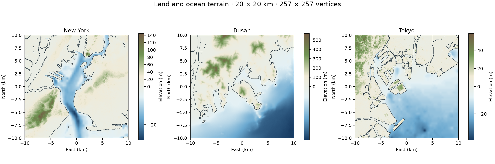

# 도시 지형 예제

[English](README.md)

각 묶음은 20 × 20 km 지역의 육지와 해저를 포함합니다. 격자는 257 × 257 꼭짓점이며 간격은 78.125 m입니다. 지리 좌표는 WGS84, 수치 지형은 로컬 x 동쪽·y 북쪽·z 위쪽을 m 단위로 사용합니다.



| 도시 | 중심 위도 / 경도 | 지형 묶음 |
|---|---|---|
| 뉴욕 | 40.65° / −74.035° | [new-york.zip](terrains/new-york.zip) |
| 부산 | 35.09° / 129.055° | [busan.zip](terrains/busan.zip) |
| 도쿄 | 35.60° / 139.83° | [tokyo.zip](terrains/tokyo.zip) |

압축을 풀면 `manifest.json`으로 출처를 확인하고 `projected.npz`를 읽거나 상대경로 `world.sdf`와 메시를 사용할 수 있습니다. SDF에는 지형과 센서 시스템 선언이 있습니다. 전체 시뮬레이션에는 POSIM 월드의 물리·파도·렌더링·차량 설정을 연결합니다.

```sh
python -m posim_terrain --spec examples/new-york.json --output out/new-york
python -m posim_terrain --spec examples/busan.json --output out/busan
python -m posim_terrain --spec examples/tokyo.json --output out/tokyo
```

자료는 GEBCO 2026·Copernicus GLO-30·Copernicus Marine SDB와 이용 가능한 KHOA BADA2024입니다. 기록에 자료별 범위·해시·수직 기준 가정을 남깁니다. 격자 간격은 측정 정확도를 높이지 않습니다. [출처 고지](../NOTICE.md)를 확인하세요.

[체크섬](terrains/SHA256SUMS)과 [수치 목록](terrains/catalog.json)을 함께 제공합니다.
