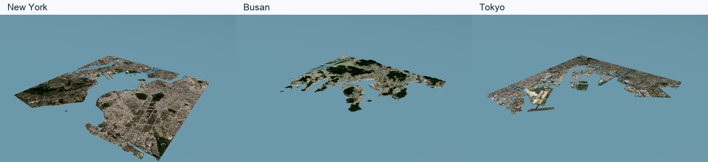

# City terrain examples

[한국어](README.ko.md)

Each bundle contains land and seabed in a 20 × 20 km region with 257 × 257 vertices (78.125 m spacing). Coordinates are WGS84; the numeric field uses local x east, y north and z up in metres.



| City | Centre latitude / longitude | Terrain bundle |
|---|---|---|
| New York | 40.65° / −74.035° | [new-york.zip](terrains/new-york.zip) |
| Busan | 35.09° / 129.055° | [busan.zip](terrains/busan.zip) |
| Tokyo | 35.60° / 139.83° | [tokyo.zip](terrains/tokyo.zip) |

Unzip a bundle to read `manifest.json`, inspect `projected.npz`, or load the relative-path `world.sdf` and meshes. `world.sdf` contains the textured terrain. `preview.sdf` includes physics, rendering, two cameras and a flat sea surface at 0 m. Connect vehicle and wave settings from your POSIM world for a voyage.

```sh
python -m posim_terrain.coastal_detail --spec examples/new-york.json
python -m posim_terrain --spec examples/new-york.json --output out/new-york
python -m posim_terrain.coastal_detail --spec examples/busan.json
python -m posim_terrain --spec examples/busan.json --output out/busan
python -m posim_terrain.coastal_detail --spec examples/tokyo.json
python -m posim_terrain --spec examples/tokyo.json --output out/tokyo
```

Sources include GEBCO 2026, Copernicus GLO-30, Copernicus Marine SDB and KHOA BADA2024 where available. Manifests retain exact per-provider coverage, hashes and vertical datum assumptions. Grid spacing does not improve measurement accuracy. See [source notices](../NOTICE.md).

[Checksums](terrains/SHA256SUMS) and [numeric catalogue](terrains/catalog.json) accompany the bundles.

## 3D world captures

These images are Gazebo Sim 10 / Ogre2 Metal camera frames. Elevation scale is 1:1. Satellite scene identifiers, acquisition dates, asset URLs and checksums are recorded in each terrain manifest.

| City | World view | Harbour view |
|---|---|---|
| New York | [Full resolution](renders/new-york-world.png) | [Full resolution](renders/new-york-harbour.png) |
| Busan | [Full resolution](renders/busan-world.png) | [Full resolution](renders/busan-harbour.png) |
| Tokyo | [Full resolution](renders/tokyo-world.png) | [Full resolution](renders/tokyo-harbour.png) |

[Capture metadata](renders/capture-report.json) · [Numeric elevation maps](cities.png)
